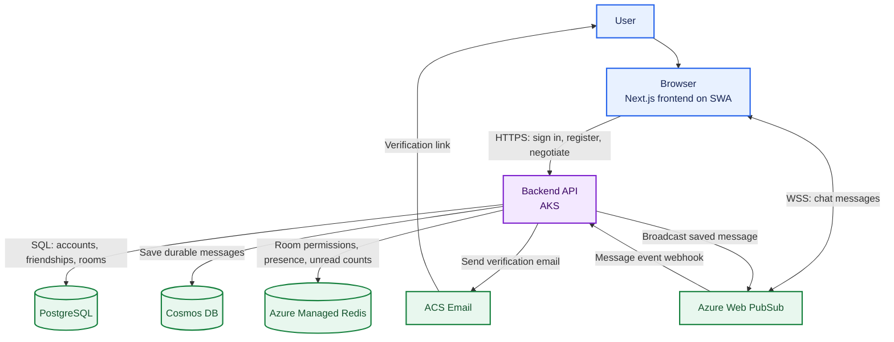

# Distributed Chat — High-Level Architecture

## What we are building

A browser-based chat application with account registration and email verification, direct real-time messaging, durable conversation history, and online presence. Static UI delivery, application logic, real-time socket management, persistent data, and short-lived presence state are separated so each can scale and be operated independently.

This is an architecture explanation for people, not an implementation checklist. The existing `chat-webapp/` is a Next.js/React application using Better Auth, Drizzle, and PostgreSQL; snippets below illustrate intended integration points and are conceptual rather than drop-in code. The project plan's target runtime is Azure.

## The pieces and why they exist

| Component | Responsibility | Why it is separate |
| --- | --- | --- |
| Next.js frontend on Azure Static Web Apps (SWA) | Screens, registration/login, conversation UI, and Web PubSub client connection | Serves frontend assets globally; the selected Next.js mode must be compatible with SWA (hybrid rendering is currently preview). |
| Backend API on Azure Kubernetes Service (AKS) | Authentication integration, authorization, negotiation, Web PubSub event handling, validation, and orchestration | Web PubSub owns persistent client sockets, so AKS replicas stay stateless and need no sticky sessions. This enables rolling deployments and horizontal scaling; exact HPA/KEDA policies are intentionally deferred until workload requirements are known. Do not trust identity or permissions supplied only by the browser. |
| Azure Communication Services (ACS) Email | Registration/verification and other authentication-related transactional email | Email delivery is a provider integration; the application owns token creation, verification, and account state. |
| Azure Web PubSub | Browser WebSocket connections, groups, and message fan-out | It owns persistent sockets so application pods do not need sticky sessions. |
| Azure Cosmos DB | Durable chat messages/history | Message writes and conversation-scoped queries scale independently of relational account data. Partition messages by `/conversationId`. |
| Azure Database for PostgreSQL Flexible Server | Users, auth-related records, conversations/groups, friendships, last-read positions, and application settings | Relational constraints and transactions suit account and relationship data. |
| Azure Managed Redis | Cached room permissions/available-room lists, presence TTLs, typing indicators, rate-limit state, and derived unread counters | It avoids repeated relational membership reads on the hot message path; PostgreSQL remains the durable source of truth for relationships, and room-permission entries must be invalidated when relationships or room membership change. Unread counters are derived and updated idempotently from persisted message events. |
| OpenTofu + GitHub Actions | Versioned Azure infrastructure and application CI/CD | OpenTofu changes are validated in CI but applied manually; application build and frontend SWA delivery are automated according to the workflow described below. |

## How a user experiences the system

### 1. Registration and verification

1. The browser submits registration to the backend over HTTPS.
2. The backend validates input and abuse limits, creates a pending account in PostgreSQL, and generates a cryptographically random, single-use, expiring verification token. Store only a hash of the token.
3. The backend asks ACS Email to deliver a verification link/code. The link contains a short-lived token, never a password or long-lived credential.
4. The user verifies. The backend hashes and compares the presented token, checks expiry and unused status, consumes it atomically, and activates the account.
5. Registration/resend responses should not reveal whether an address is already registered. Sending is retryable, rate-limited, and must not activate an account on delivery failure.

**Azure SDK direction:** use `@azure/communication-email` (`EmailClient`) and `@azure/identity` (`DefaultAzureCredential`). The endpoint is the ACS resource endpoint; `senderAddress` must belong to a verified Email Communication Services domain. Grant the backend workload identity the ACS email sending role. Keep all of this server-side.

```ts
import { DefaultAzureCredential } from "@azure/identity";
import { EmailClient } from "@azure/communication-email";

const emailClient = new EmailClient(
  process.env.ACS_EMAIL_ENDPOINT!,
  new DefaultAzureCredential(),
);

async function sendVerificationEmail(to: string, link: string): Promise<void> {
  const poller = await emailClient.beginSend({
    senderAddress: process.env.ACS_SENDER_ADDRESS!,
    recipients: { to: [{ address: to }] },
    content: {
      subject: "Verify your account",
      plainText: `Complete registration: ${link}`,
    },
  });
  const result = await poller.pollUntilDone();
  if (result.status !== "Succeeded") {
    throw new Error(`ACS email send failed: ${result.status}`);
  }
}
```

The ACS SDK's `beginSend()` returns a poller: `pollUntilDone()` waits for the send operation's result. In production, catch and classify SDK errors, log a correlation/operation ID rather than the token or email body, and use a durable retry/outbox policy if required. `DefaultAzureCredential` uses local developer credentials in development and the configured workload identity in Azure; it does not remove the need for correct Azure role assignment.

### 2. Authentication, session, and authorization

**Current implementation:** Better Auth validates its PostgreSQL-backed session when the server needs the session. The app does not currently issue its own JWT access tokens. Azure SDK integration for email or Web PubSub does not change this authentication model.

**Preferred target, subject to an implementation-complexity review:** after login, issue a short-lived signed access JWT and a longer-lived opaque session/refresh token. The browser keeps credentials in secure, `HttpOnly` cookies (not local storage). Store only a hash of the refresh token in PostgreSQL. The backend verifies access JWT signatures locally using a private signing key and does not query PostgreSQL for every request solely to identify the user. Keep signing private-key material in Azure Key Vault where practical; if managing keys safely adds disproportionate complexity, retain Better Auth's current PostgreSQL-backed session validation rather than building a fragile custom token system. This is an explicit fallback, not a blocker for the project.

**Authorization is separate from authentication.** PostgreSQL is authoritative for friendships, group membership, and room access. Redis caches each user's available-room/permission data so a message send does not need a PostgreSQL membership query each time. When someone is added to or removed from a group, or a friendship is created or removed, commit the canonical relationship change in PostgreSQL and invalidate/rebuild the affected user's Redis permission cache. Use a reliable invalidation mechanism (such as a PostgreSQL transactional outbox), so cache changes are not silently lost. Define how quickly revocation must take effect; use a fail-closed policy or short cache TTL if Redis/invalidation is unavailable. Never trust a room list or permission claim supplied by the browser.

After login, the browser requests a Web PubSub connection credential from the backend. The backend authenticates the user's app session/access token, checks that the account is verified, and asks Web PubSub for a narrowly scoped client URL/token. It authorizes room joins using the room-permission service backed by Redis/PostgreSQL. The browser connects directly to Web PubSub with that short-lived credential. The browser must not select an arbitrary user ID as its identity.

**Azure SDK direction:** the backend uses `@azure/web-pubsub` (`WebPubSubServiceClient`) to mint a short-lived client access URL. The browser uses `@azure/web-pubsub-client` (`WebPubSubClient`), not a raw WebSocket, so its SDK can handle the service protocol and reconnect behavior. The backend authenticates from the existing session and sets the user ID itself.

```ts
// Backend: create once at startup. Endpoint is the Web PubSub service endpoint.
import { DefaultAzureCredential } from "@azure/identity";
import { WebPubSubServiceClient } from "@azure/web-pubsub";

const pubsub = new WebPubSubServiceClient(
  process.env.WEBPUBSUB_ENDPOINT!,
  process.env.WEBPUBSUB_HUB!,
  new DefaultAzureCredential(),
);

// In the authenticated negotiate route; never accept userId from request input.
const { url } = await pubsub.getClientAccessToken({
  userId: session.user.id,
  roles: ["webpubsub.joinLeaveGroup"],
});
return Response.json({ url }); // URL includes a bearer token: do not log/cache it.
```

```ts
// Browser: install @azure/web-pubsub-client; only receive the short-lived URL.
import { WebPubSubClient } from "@azure/web-pubsub-client";

const { url } = await fetch("/api/negotiate", {
  method: "POST",
  credentials: "include",
}).then((r) => r.json());
const client = new WebPubSubClient({ getClientAccessUrl: async () => url });
await client.start();
client.on("group-message", (event) => renderMessage(event.message));
await client.joinGroup("conversation-id"); // only after trusted authorization permits this group
await client.sendEvent("chatMessage", { conversationId: "conversation-id", text: "Hello" }, "json");
```

Role strings must match the client's intended capabilities and the exact event/group model; minimize them. Do **not** grant `webpubsub.sendToGroup` to a client if messages must pass through the backend for membership checks and durable persistence. Configure the hub to forward client events to the backend, or use an appropriately restricted event permission supported by the chosen protocol. The negotiate route must require a verified account, return `Cache-Control: no-store`, and avoid exposing a long-lived service credential. Group joins and membership authorization remain trusted-server responsibilities.

### 3. Sending and receiving messages

A chat message passes through two different programs. The **frontend** sends an event to Web PubSub using its client SDK. Azure forwards that event to a **backend webhook** as a CloudEvent. The backend validates it, checks the sender's conversation membership, saves the message in Cosmos DB using the official `@azure/cosmos` SDK, updates Redis unread counters idempotently for the other conversation members, then uses the Web PubSub server SDK to broadcast the saved message to that conversation's group. Other browsers receive the group message and render it. Clients do not write directly to Cosmos DB or broadcast directly to groups. PostgreSQL stores each user's durable last-read position; Redis counters are derived, rebuilt from messages after that position, and reset/reconciled when the user reads the conversation. When a message is accepted, increment unread counts for eligible recipients other than the sender exactly once. When a user reads a conversation, persist the read position in PostgreSQL and reset/reconcile the Redis counter; never treat a client-provided badge count as authoritative.

#### Frontend — send an event and listen for group messages

This runs in the browser after the authenticated negotiate API has returned a short-lived Web PubSub client URL. The hub must be configured to forward the `chatMessage` user event to the backend. The browser does not choose its sender ID; the service associates the connection with the authenticated user established during negotiation.

```ts
// Browser code — package: @azure/web-pubsub-client
import { WebPubSubClient } from "@azure/web-pubsub-client";

const { url } = await fetch("/api/negotiate", {
  method: "POST",
  credentials: "include",
}).then((response) => response.json());

const client = new WebPubSubClient({ getClientAccessUrl: async () => url });
client.on("group-message", ({ message }) => renderMessage(message));
await client.start();

// Sends to the service's configured event handler; it does NOT broadcast to a group.
await client.sendEvent(
  "chatMessage",
  { conversationId: "conversation-123", text: "Hello" },
  "json",
);
```

#### Backend — validate, persist, then broadcast

This is server-side webhook code (for example, in a Next.js route at `app/api/webhooks/webpubsub/route.ts`). Azure Web PubSub calls this endpoint when the hub event handler forwards the `chatMessage` event. `verifyWebPubSubCloudEvent` stands for validation of the CloudEvents request and configured webhook authentication; `requireConversationMember` and `messages.insertOnce` are application-owned authorization/storage functions, not Azure SDK methods. The sender ID must come from the trusted Web PubSub event/connection context, never from the message body.

```ts
// Backend code — package: @azure/web-pubsub
import { WebPubSubServiceClient } from "@azure/web-pubsub";
import { DefaultAzureCredential } from "@azure/identity";

const pubsub = new WebPubSubServiceClient(
  process.env.WEBPUBSUB_ENDPOINT!,
  process.env.WEBPUBSUB_HUB!,
  new DefaultAzureCredential(),
);

export async function handleChatMessageWebhook(request: Request): Promise<Response> {
  const event = await verifyWebPubSubCloudEvent(request); // validate before trusting event data
  if (event.type !== "azure.webpubsub.user.chatMessage") return new Response(null, { status: 204 });

  const { conversationId, text } = validateChatPayload(event.data.data);
  const senderId = event.data.userId; // assigned from the authenticated Web PubSub connection
  await requireConversationMember(senderId, conversationId);

  const message = await messages.insertOnce({
    id: event.id, // stable event/message ID used to make webhook retries idempotent
    conversationId,
    senderId,
    text,
    createdAt: new Date(),
  });

  // Azure SDK call: publish only after persistence and authorization succeed.
  await pubsub.group(conversationId).sendToAll(message);
  return new Response(null, { status: 204 });
}
```

`WebPubSubServiceClient` is the **server SDK** and `group(...).sendToAll(...)` performs Azure fan-out; `WebPubSubClient` is the **browser SDK**. Use the official Azure SDK where one is the appropriate data-plane client: for Cosmos DB, use `@azure/cosmos` (`CosmosClient`). PostgreSQL and Redis use their standard protocol clients; Redis data operations use the original `ioredis` choice, not an Azure management SDK.

```ts
// Backend startup: package @azure/cosmos; authenticate with the workload identity.
import { CosmosClient } from "@azure/cosmos";
import { DefaultAzureCredential } from "@azure/identity";

const cosmos = new CosmosClient({
  endpoint: process.env.COSMOS_ENDPOINT!,
  aadCredentials: new DefaultAzureCredential(),
});
const messagesContainer = cosmos
  .database(process.env.COSMOS_DATABASE!)
  .container(process.env.COSMOS_MESSAGES_CONTAINER!);

// In the webhook, after authorization. conversationId is the partition key.
await messagesContainer.items.create({
  id: messageId,
  conversationId,
  senderId,
  text,
  createdAt: new Date().toISOString(),
});
// In a real handler, update recipient unread counters idempotently after this write.
```

The shown webhook/event types are illustrative: configure and test the hub's event handler, CloudEvents validation handshake, authentication, and exact event envelope together. Retry handling must avoid duplicate persistence, unread-counter increments, and fan-out, and define what happens if persistence succeeds but broadcasting fails. See [Web Pub Sub server SDK](https://learn.microsoft.com/en-us/azure/azure-web-pubsub/reference-server-sdk-js), [Web Pub Sub client SDK](https://learn.microsoft.com/en-us/azure/azure-web-pubsub/reference-client-sdk-javascript), and [Cosmos SDK](https://learn.microsoft.com/en-us/javascript/api/%40azure/cosmos/cosmosclient) for package/API details.

### 4. Presence and ephemeral state

A connected client emits a heartbeat, for example every 30 seconds. A trusted backend handler refreshes a Redis key with a TTL, for example 60 seconds. Missing heartbeats allow the key to expire naturally. Presence is a best-effort view, not permanent user data. Typing indicators use short TTLs (for example, 3–5 seconds), and API abuse protection can use sliding-window or token-bucket rate limits in Redis. Apply limits and validate event types to prevent arbitrary key writes or abuse.

**Redis client direction:** Azure Managed Redis exposes the Redis protocol rather than a service-specific data SDK. Preserve the original `ioredis` choice and use its `SET key value EX seconds` command for TTLs. Configure TLS and the selected supported authentication mode for the provisioned SKU; do not assume Azure SDK credentials automatically authenticate a generic Redis client.

```ts
import Redis from "ioredis";

const redis = new Redis(process.env.REDIS_URL!, { tls: {} }); // one shared connection per backend process
redis.on("error", (error) => logger.error({ error }, "Redis client error"));

// Called by a trusted, authenticated heartbeat handler, never arbitrary browser input.
await redis.set(`presence:${userId}`, "online", "EX", 60);
```

Use a connection lifecycle shared by the server process, not a new connection per heartbeat. Configure the URL/auth according to the deployed service; keep it secret and never send it to the browser. If Redis is unavailable, presence may degrade without losing durable account/message data.

## End-to-end picture

The Azure resources below are deployed first in a dedicated, isolated dev environment for frontend/backend development and integration testing. Production uses a separate environment and infrastructure state; the full production topology does not need to exist before dev integration begins.



## Security and reliability principles

- Use HTTPS/WSS; authenticate every API and authorize every conversation operation.
- Use short-lived, scoped Web PubSub client tokens. Never trust a browser-provided user ID as proof of identity.
- Use managed identity/workload identity for Azure service access where supported; grant least privilege. Treat PostgreSQL and Redis connectivity/authentication as explicit configuration, not as magically supplied by a managed identity.
- Keep email sender/domain configuration environment-specific. Verify sender/domain and DNS before production sending. Do not log verification tokens, passwords, or sensitive email bodies.
- Hash passwords with a suitable password-hashing scheme; hash, expire, and consume verification tokens once.
- Persist messages durably before publishing; make webhook handling idempotent and define retry behavior.
- PostgreSQL and Cosmos DB own durable data in their respective domains. Redis is a derived cache: presence/typing expire naturally, while room-permission entries must be explicitly invalidated/rebuilt when source relationships change and also have a bounded TTL.
- Validate all external inputs, rate-limit registration/resend/auth and messaging actions, and use generic auth responses where appropriate.

## Build, delivery, and infrastructure workflow

- **Application tests:** GitHub Actions runs frontend/backend lint, typecheck, tests, and build validation on pull requests. Backend PR builds validate the Docker image but do not publish it.
- **Backend image pipeline:** merges to the default branch build and publish a versioned backend image to Azure Container Registry (ACR). AKS deployment remains a manual operation; the build workflow does not apply Kubernetes manifests.
- **Frontend pipeline:** connect the frontend repository to Azure Static Web Apps and use its generated GitHub Actions workflow with the official `Azure/static-web-apps-deploy` action. Pull requests use preview environments; pushes to the default branch deploy to production SWA. SWA builds and deploys directly, so no separate frontend blob artifact store is planned. Next.js hybrid hosting is documented as preview; verify the project's Next.js version/features against current SWA limits.
- **Infrastructure checks/deployment:** a GitHub Actions workflow runs OpenTofu formatting and syntax/validation checks only. It does not run `plan` or `apply`. Operators manually deploy OpenTofu changes to dev or production; infrastructure deployment is never triggered automatically by a merge.
- **Application team:** owns the Next.js UI, backend/API and domain behavior, database migrations/schemas, Azure SDK integration, tests, container image, and runtime configuration contract. The primary shared development/integration target is a dedicated Azure dev environment; local fakes are for unit tests, not a separate full local Azure stack.
- **Platform/DevOps team:** owns OpenTofu modules/stacks, the isolated Azure dev environment (provisioned incrementally), production Azure resources/networking/identity/RBAC, remote state, and infrastructure validation workflow.
- **Shared interface:** documented endpoints/events, environment-variable names (values managed securely), identity/resource IDs, DNS/origin requirements, and deployment outputs. Dev and production are separate environments/states; real Azure integration is tested against dev before production.

See [AGENT-IMPLEMENTATION.md](AGENT-IMPLEMENTATION.md) for ordered, agent-oriented work and acceptance criteria.